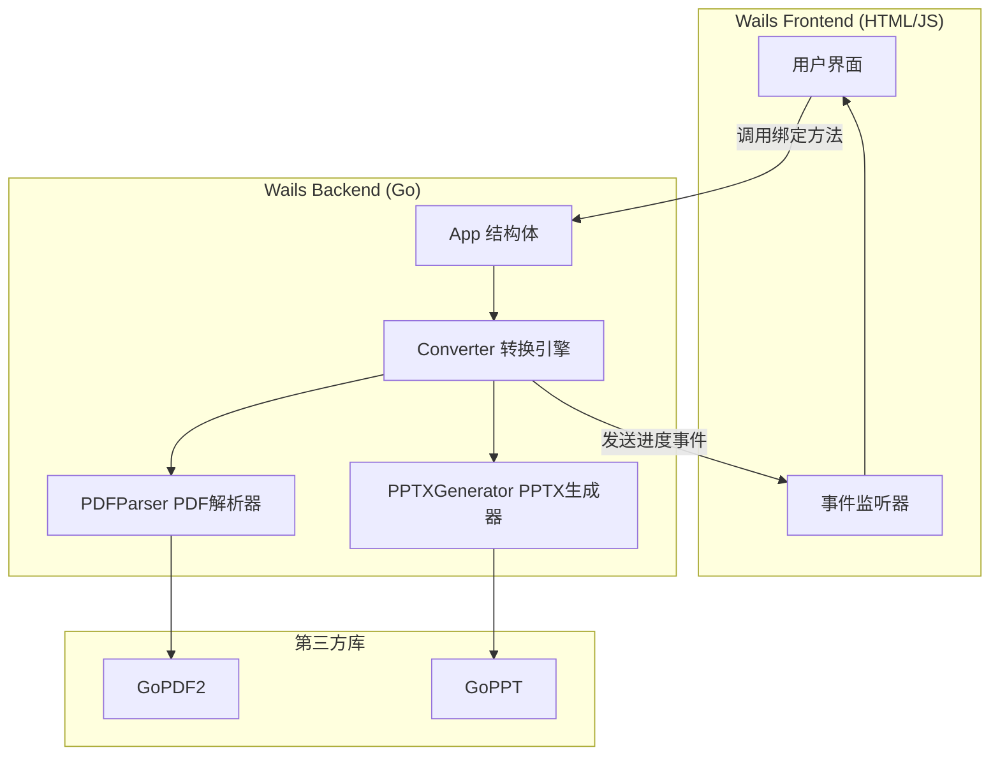
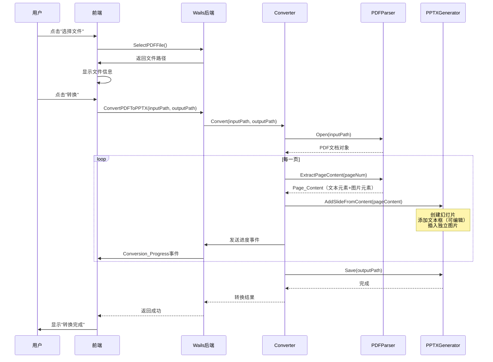

# 技术设计文档：PDF 转可编辑 PPTX

## 概述

本设计文档描述了基于 Wails 框架的 Go 桌面应用中 PDF 转可编辑 PPTX 功能的技术实现方案。该功能使用 GoPDF2 库解析 PDF 文件的每一页，提取其中的文本元素（含字体、大小、颜色、位置）和图片元素（含二进制数据、格式、位置），然后使用 GoPPT 库生成 PPTX 文件，每页 PDF 对应一张幻灯片，文本以可编辑文本框形式呈现，图片以独立图片元素插入，尽可能保留原始格式和布局。

### 核心技术栈

- **语言**: Go
- **桌面框架**: Wails v2
- **PDF 解析**: GoPDF2 (`github.com/Vantagics/GoPDF2`)
- **PPTX 生成**: GoPPT (`github.com/Vantagics/GoPPT`)
- **测试样本**: `test.pdf`（工作区根目录）

### 设计目标

1. 从 PDF 每一页中提取文本和图片等可编辑元素，生成包含可编辑文本框和独立图片的 PPTX 幻灯片
2. 尽可能保留原始字体名称、大小、颜色、位置坐标和尺寸信息
3. 提供实时转换进度反馈
4. 健壮的错误处理：单个元素失败不影响其余元素，转换失败时清理临时文件
5. 清晰的前后端分离架构

## 架构

### 整体架构

应用采用 Wails v2 的前后端分离架构。后端 Go 代码负责核心转换逻辑，前端通过 Wails 绑定调用后端方法，并通过事件机制接收进度更新。



### 转换流程



## 组件与接口

### 1. App 结构体（Wails 后端入口）

`App` 是 Wails 应用的主结构体，暴露给前端调用的方法绑定在此。

```go
// App 是 Wails 应用的主结构体
type App struct {
    ctx       context.Context
    converter *Converter
}

// SelectPDFFile 打开文件选择对话框，返回所选 PDF 文件路径
// 返回空字符串表示用户取消了选择
func (a *App) SelectPDFFile() (string, error)

// ConvertPDFToPPTX 执行 PDF 到可编辑 PPTX 的转换
// inputPath: PDF 文件路径
// outputPath: PPTX 输出路径
func (a *App) ConvertPDFToPPTX(inputPath, outputPath string) error

// OpenOutputDirectory 打开文件所在目录
func (a *App) OpenOutputDirectory(filePath string) error

// GetDefaultOutputPath 根据输入 PDF 路径生成默认的 PPTX 输出路径
func (a *App) GetDefaultOutputPath(inputPath string) string
```

### 2. Converter（转换引擎）

`Converter` 协调 PDF 内容提取和可编辑 PPTX 生成的完整流程。

```go
// ProgressCallback 进度回调函数类型
type ProgressCallback func(current, total int)

// ConvertResult 转换结果
type ConvertResult struct {
    OutputPath string
    PageCount  int
}

// Converter PDF 转可编辑 PPTX 转换引擎
type Converter struct {
    parser     *PDFParser
    generator  *PPTXGenerator
    onProgress ProgressCallback
}

// NewConverter 创建转换引擎实例
func NewConverter(onProgress ProgressCallback) *Converter

// Convert 执行转换：提取PDF元素 → 生成可编辑PPTX
// 转换失败时清理临时文件和不完整的输出文件
func (c *Converter) Convert(inputPath, outputPath string) (*ConvertResult, error)
```

**Convert 方法核心流程：**
1. 调用 `parser.Open(inputPath)` 打开并验证 PDF
2. 获取总页数，若为 0 则返回错误
3. 循环每一页：
   a. 调用 `parser.ExtractPageContent(pageNum)` 提取 Page_Content
   b. 调用 `generator.AddSlideFromContent(pageContent)` 创建可编辑幻灯片
   c. 发送进度回调
4. 调用 `generator.Save(outputPath)` 保存 PPTX
5. 出错时清理不完整的输出文件

### 3. PDFParser（PDF 解析器）

`PDFParser` 封装 GoPDF2 库，提供 PDF 文件解析和元素提取能力。

```go
// PDFParser PDF 文件解析器
type PDFParser struct {
    doc *gopdf2.Document // GoPDF2 文档对象
}

// NewPDFParser 创建 PDF 解析器
func NewPDFParser() *PDFParser

// Open 打开并验证 PDF 文件
// 验证文件是否存在、是否可读、是否为有效 PDF 格式
func (p *PDFParser) Open(filePath string) error

// GetPageCount 获取 PDF 总页数
func (p *PDFParser) GetPageCount() int

// ExtractPageContent 提取指定页面的所有可编辑元素
// pageNum 从 0 开始
// 返回 Page_Content，包含该页的所有 Text_Element 和 Image_Element
func (p *PDFParser) ExtractPageContent(pageNum int) (*PageContent, error)

// Close 关闭 PDF 文档，释放资源
func (p *PDFParser) Close() error
```

**ExtractPageContent 内部流程：**
1. 获取页面宽高尺寸（磅/points）
2. 遍历页面中的文本对象，为每段文本创建 `TextElement`：
   - 提取文本内容字符串
   - 提取字体名称（缺失时使用 "Arial"）
   - 提取字体大小（缺失时使用 12.0 磅）
   - 提取字体颜色 RGB 值（缺失时使用黑色 #000000）
   - 提取位置坐标 (X, Y) 和文本区域尺寸 (Width, Height)
3. 遍历页面中的图片对象，为每张图片创建 `ImageElement`：
   - 提取图片二进制数据
   - 识别图片格式（PNG、JPEG 等）
   - 提取位置坐标 (X, Y) 和图片尺寸 (Width, Height)
4. 组装为 `PageContent` 返回

### 4. PPTXGenerator（PPTX 生成器）

`PPTXGenerator` 封装 GoPPT 库，提供包含可编辑元素的 PPTX 文件生成能力。

```go
// PPTXGenerator PPTX 文件生成器
type PPTXGenerator struct {
    ppt *goppt.Presentation // GoPPT 演示文稿对象
}

// NewPPTXGenerator 创建 PPTX 生成器
func NewPPTXGenerator() *PPTXGenerator

// AddSlideFromContent 根据 Page_Content 添加一张包含可编辑元素的幻灯片
// 为每个 TextElement 创建可编辑文本框，为每个 ImageElement 插入独立图片
// 单个元素创建失败时跳过该元素并记录警告，继续处理剩余元素
func (g *PPTXGenerator) AddSlideFromContent(content *PageContent) error

// Save 将 PPTX 文件保存到指定路径
func (g *PPTXGenerator) Save(outputPath string) error

// Close 关闭并清理资源
func (g *PPTXGenerator) Close() error
```

**AddSlideFromContent 内部流程：**
1. 创建新幻灯片，设置尺寸为 Page_Content 中的页面宽高（磅转 EMU）
2. 遍历 `TextElements`：
   a. 在对应位置创建文本框（位置和尺寸从磅转 EMU）
   b. 设置文本内容
   c. 设置字体名称、大小、颜色
   d. 单个文本框创建失败时记录警告并跳过
3. 遍历 `ImageElements`：
   a. 在对应位置插入图片（位置和尺寸从磅转 EMU）
   b. 设置图片二进制数据和格式
   c. 单个图片插入失败时记录警告并跳过

### 5. 前端接口

前端通过 Wails 运行时调用后端方法：

```javascript
// 调用后端方法
window.go.main.App.SelectPDFFile()
window.go.main.App.ConvertPDFToPPTX(inputPath, outputPath)
window.go.main.App.OpenOutputDirectory(filePath)
window.go.main.App.GetDefaultOutputPath(inputPath)

// 监听进度事件
runtime.EventsOn("conversion_progress", (current, total) => {
    // 更新进度条
})
```

## 数据模型

### 核心数据结构

```go
// TextElement 从 PDF 页面中提取的文本元素
type TextElement struct {
    Content  string  `json:"content"`  // 文本内容
    FontName string  `json:"fontName"` // 字体名称（缺失时为 "Arial"）
    FontSize float64 `json:"fontSize"` // 字体大小（磅，缺失时为 12.0）
    ColorR   uint8   `json:"colorR"`   // 字体颜色 R 分量
    ColorG   uint8   `json:"colorG"`   // 字体颜色 G 分量
    ColorB   uint8   `json:"colorB"`   // 字体颜色 B 分量
    X        float64 `json:"x"`        // 位置 X 坐标（磅）
    Y        float64 `json:"y"`        // 位置 Y 坐标（磅）
    Width    float64 `json:"width"`    // 文本区域宽度（磅）
    Height   float64 `json:"height"`   // 文本区域高度（磅）
}

// ImageElement 从 PDF 页面中提取的图片元素
type ImageElement struct {
    Data   []byte  `json:"-"`        // 图片二进制数据
    Format string  `json:"format"`   // 图片格式（"png", "jpeg" 等）
    X      float64 `json:"x"`        // 位置 X 坐标（磅）
    Y      float64 `json:"y"`        // 位置 Y 坐标（磅）
    Width  float64 `json:"width"`    // 图片宽度（磅）
    Height float64 `json:"height"`   // 图片高度（磅）
}

// PageContent 一个 PDF 页面中提取的所有元素集合
type PageContent struct {
    PageWidth     float64        `json:"pageWidth"`     // 页面宽度（磅）
    PageHeight    float64        `json:"pageHeight"`    // 页面高度（磅）
    TextElements  []TextElement  `json:"textElements"`  // 文本元素列表
    ImageElements []ImageElement `json:"imageElements"` // 图片元素列表
}

// ConversionProgress 转换进度信息，通过 Wails 事件发送给前端
type ConversionProgress struct {
    Current int `json:"current"` // 当前处理的页码（从 1 开始）
    Total   int `json:"total"`   // 总页数
}

// ConvertResult 转换结果
type ConvertResult struct {
    OutputPath string `json:"outputPath"` // 输出文件路径
    PageCount  int    `json:"pageCount"`  // 转换的总页数
}

// ConvertError 转换错误
type ConvertError struct {
    Code    string `json:"code"`    // 错误代码
    Message string `json:"message"` // 错误描述
}
```

### 默认值常量

```go
const (
    DefaultFontName = "Arial"
    DefaultFontSize = 12.0
    DefaultColorR   = 0
    DefaultColorG   = 0
    DefaultColorB   = 0
)
```

### 错误代码定义

| 错误代码 | 描述 | 对应需求 |
|---------|------|---------|
| `INVALID_PDF` | 文件不是有效的 PDF 格式 | 2.2 |
| `EMPTY_PDF` | PDF 文件不包含任何页面 | 2.3 |
| `FILE_NOT_READABLE` | 无法读取文件 | 2.4 |
| `PAGE_EXTRACT_ERROR` | 提取某一页内容时发生错误 | 3.6 |
| `WRITE_ERROR` | 无法写入目标路径 | 5.4 |
| `INTERNAL_ERROR` | 转换过程中发生内部错误 | 7.4 |

### 单位转换

PDF 使用磅（points）作为尺寸单位，PPTX 使用 EMU（English Metric Units）。转换关系：

```
1 磅 = 12700 EMU
1 英寸 = 72 磅 = 914400 EMU
```

```go
// PointsToEMU 将磅值转换为 EMU
func PointsToEMU(points float64) int64 {
    return int64(points * 12700)
}
```

### 项目目录结构

```
pdf2ppt/
├── main.go                    # Wails 应用入口
├── app.go                     # App 结构体及 Wails 绑定方法
├── converter/
│   ├── converter.go           # Converter 转换引擎
│   ├── converter_test.go      # Converter 单元测试和属性测试
│   ├── models.go              # 数据模型定义（TextElement, ImageElement, PageContent 等）
│   ├── pdf_parser.go          # PDFParser PDF 解析器
│   ├── pdf_parser_test.go     # PDFParser 测试
│   ├── pptx_generator.go      # PPTXGenerator PPTX 生成器
│   └── pptx_generator_test.go # PPTXGenerator 测试
├── frontend/
│   ├── index.html             # 前端页面
│   ├── src/
│   │   ├── main.js            # 前端入口
│   │   └── style.css          # 样式
│   └── wailsjs/               # Wails 自动生成的绑定
├── test.pdf                   # 测试样本文件
├── go.mod
├── go.sum
└── wails.json                 # Wails 配置
```

## 正确性属性（Correctness Properties）

*属性是一种在系统所有有效执行中都应成立的特征或行为——本质上是关于系统应该做什么的形式化陈述。属性是人类可读规范与机器可验证正确性保证之间的桥梁。*

### 属性 1：页面数量守恒

*对于任意* N 页的有效 PDF 文件，转换生成的 PPTX 文件应恰好包含 N 张幻灯片。

**验证需求: 3.1, 4.1**

### 属性 2：页面尺寸保持

*对于任意* PDF 页面，其对应的 PPTX 幻灯片尺寸（宽度和高度）应与 PDF 页面的尺寸一致（经过磅到 EMU 的单位转换后）。

**验证需求: 3.2, 4.2**

### 属性 3：文本元素保真

*对于任意* PDF 页面中的文本元素，其对应的 PPTX 幻灯片中应包含一个可编辑文本框，该文本框的文本内容、位置坐标 (X, Y)、尺寸 (Width, Height)、字体名称、字体大小和字体颜色均与原始 Text_Element 中记录的信息一致。

**验证需求: 3.3, 3.5, 4.3, 4.4**

### 属性 4：图片元素保真

*对于任意* PDF 页面中的图片元素，其对应的 PPTX 幻灯片中应包含一张独立图片，该图片的二进制数据、格式、位置坐标 (X, Y) 和尺寸 (Width, Height) 均与原始 Image_Element 中记录的信息一致。

**验证需求: 3.4, 4.5**

### 属性 5：字体缺失时的默认值回退

*对于任意* 字体信息无法完整提取的文本元素，PDF_Parser 应将其字体名称设为 "Arial"，字体大小设为 12 磅。

**验证需求: 3.7**

### 属性 6：幻灯片顺序保持

*对于任意* 多页 PDF 文件，生成的 PPTX 中幻灯片的顺序应与 PDF 页面的原始顺序完全一致。

**验证需求: 4.6**

### 属性 7：元素级错误容忍

*对于任意* 包含多个文本和图片元素的 Page_Content，如果其中某个元素在创建时失败，PPTX_Generator 应跳过该元素并继续处理剩余元素，最终幻灯片中应包含所有成功创建的元素。

**验证需求: 4.8**

### 属性 8：进度事件完整性

*对于任意* N 页的 PDF 转换过程，Converter 应恰好发送 N 次进度回调，且第 i 次回调的 current 值为 i，total 值为 N。

**验证需求: 6.1, 8.4**

### 属性 9：失败时的文件清理

*对于任意* 转换过程中发生错误的情况，Converter 应清理已生成的不完整输出文件，确保输出路径不存在残留文件。

**验证需求: 7.2**

### 属性 10：PDF 格式验证

*对于任意* 非 PDF 格式的文件（随机字节数据），PDF_Parser 的 Open 方法应返回错误，且不应成功打开该文件。

**验证需求: 2.1**

## 错误处理

### 错误处理策略

| 场景 | 处理方式 | 对应需求 |
|------|---------|---------|
| 文件不存在或无法读取 | 返回 `FILE_NOT_READABLE` 错误 | 2.4 |
| 文件不是有效 PDF | 返回 `INVALID_PDF` 错误 | 2.2 |
| PDF 页数为零 | 返回 `EMPTY_PDF` 错误 | 2.3 |
| 提取某页内容失败 | 返回 `PAGE_EXTRACT_ERROR` 错误，包含页码信息 | 3.6 |
| 字体信息缺失 | 使用默认值（Arial, 12pt, 黑色），继续处理 | 3.7 |
| 单个文本框创建失败 | 记录警告日志，跳过该元素，继续处理 | 4.8 |
| 单个图片插入失败 | 记录警告日志，跳过该元素，继续处理 | 4.8 |
| 输出路径无法写入 | 返回 `WRITE_ERROR` 错误 | 5.4 |
| 库抛出未预期异常 | 使用 recover 捕获 panic，返回 `INTERNAL_ERROR` 错误 | 7.4 |
| 转换失败 | 清理不完整的输出文件 | 7.2 |

### Panic 恢复机制

```go
func (c *Converter) Convert(inputPath, outputPath string) (result *ConvertResult, err error) {
    defer func() {
        if r := recover(); r != nil {
            err = &ConvertError{
                Code:    "INTERNAL_ERROR",
                Message: fmt.Sprintf("转换过程中发生内部错误: %v", r),
            }
            // 清理不完整的输出文件
            os.Remove(outputPath)
        }
    }()
    // ... 转换逻辑
}
```

## 测试策略

### 双重测试方法

本功能采用单元测试与属性测试相结合的方式确保正确性：

- **单元测试**：验证具体示例、边界情况和错误条件
- **属性测试**：验证在所有输入上都成立的通用属性

### 属性测试配置

- **属性测试库**: [rapid](https://github.com/flyingmutant/rapid)（Go 语言属性测试库）
- **每个属性测试最少运行 100 次迭代**
- **每个属性测试必须通过注释引用设计文档中的属性**
- **标签格式**: `Feature: pdf-to-pptx, Property {number}: {property_text}`
- **每个正确性属性由一个属性测试实现**

### 单元测试范围

单元测试聚焦于：
- 具体示例：使用 `test.pdf` 验证端到端转换
- 错误条件：无效文件、空 PDF、不可写路径等
- 边界情况：零页 PDF、字体信息缺失、单个元素失败

### 属性测试范围

属性测试覆盖设计文档中定义的 10 个正确性属性：

| 属性 | 测试策略 | 标签 |
|------|---------|------|
| 属性 1: 页面数量守恒 | 生成随机 PageContent 列表，验证幻灯片数量 | `Feature: pdf-to-pptx, Property 1: 页面数量守恒` |
| 属性 2: 页面尺寸保持 | 生成随机页面尺寸，验证磅到 EMU 转换正确性 | `Feature: pdf-to-pptx, Property 2: 页面尺寸保持` |
| 属性 3: 文本元素保真 | 生成随机 TextElement，验证文本框属性一致 | `Feature: pdf-to-pptx, Property 3: 文本元素保真` |
| 属性 4: 图片元素保真 | 生成随机 ImageElement，验证图片属性一致 | `Feature: pdf-to-pptx, Property 4: 图片元素保真` |
| 属性 5: 字体缺失默认值 | 生成缺失字体信息的 TextElement，验证默认值 | `Feature: pdf-to-pptx, Property 5: 字体缺失默认值` |
| 属性 6: 幻灯片顺序保持 | 生成随机多页内容，验证顺序一致 | `Feature: pdf-to-pptx, Property 6: 幻灯片顺序保持` |
| 属性 7: 元素级错误容忍 | 注入失败元素，验证其余元素正常处理 | `Feature: pdf-to-pptx, Property 7: 元素级错误容忍` |
| 属性 8: 进度事件完整性 | 生成随机页数，验证回调次数和参数 | `Feature: pdf-to-pptx, Property 8: 进度事件完整性` |
| 属性 9: 失败时文件清理 | 模拟转换失败，验证输出文件被清理 | `Feature: pdf-to-pptx, Property 9: 失败时文件清理` |
| 属性 10: PDF 格式验证 | 生成随机字节数据，验证被拒绝 | `Feature: pdf-to-pptx, Property 10: PDF 格式验证` |

### 测试文件组织

```
converter/
├── converter_test.go      # Converter 单元测试 + 属性测试
├── pdf_parser_test.go     # PDFParser 单元测试（使用 test.pdf）
├── pptx_generator_test.go # PPTXGenerator 单元测试 + 属性测试
└── models_test.go         # 数据模型和单位转换测试
```
